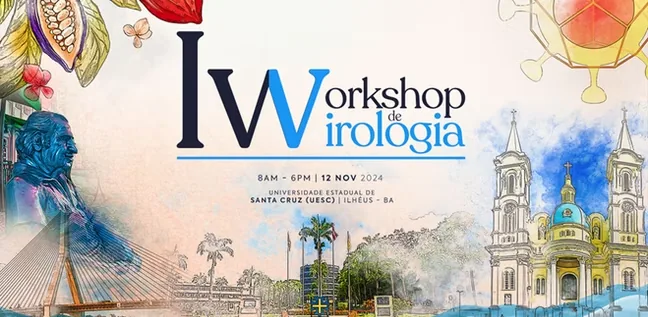
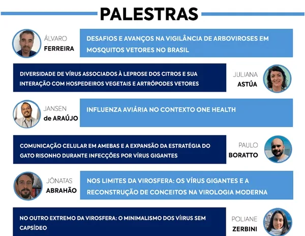
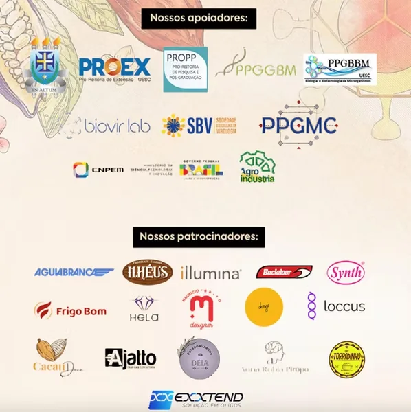
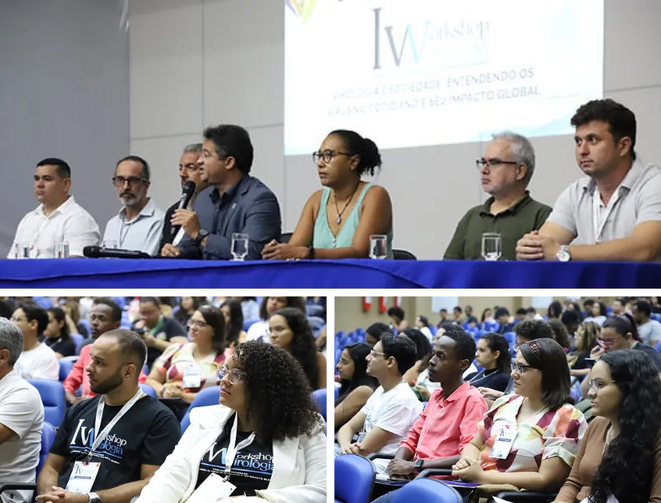

<!-- gerado por scripts/build-eventos.py - nao editar a mao;
     edite eventos/1_workshop_virologia/ e rode ./build.sh -->

<a class="no-external" href="../../events.html">← Events & news</a>

::: {.event-meta}
12 Nov 2024 · Ilhéus, Brazil
:::

{.event-cover fig-alt="I Virology Workshop"}

::: {.lead}
First Virology Workshop at UESC, organised by the Virus Bioinformatics (BioVirLab) and Applied Pathology and Genetics (LAPAGEN) laboratories.
:::

The I Virology Workshop at UESC, held on 12 November 2024, was a landmark for
science outreach in the Northeast of Brazil, bringing together students,
researchers and professionals from the health and biological sciences to discuss
the advances and challenges of virology in the country. With support from the
Brazilian Society of Virology (SBV), it was the first workshop dedicated to
virology in the South and Far South of Bahia, and featured talks by nationally
and internationally renowned experts, encouraging the exchange of knowledge, the
appreciation of science and the building of collaborative networks. The
initiative also received coverage in the regional media, reinforcing UESC's
commitment to accessible, high-quality science.

## PROGRAMME

We were delighted to welcome to the I Virology Workshop experts from several
leading Brazilian and international institutions, such as the Brazilian Center
for Research in Energy and Materials (CNPEM), the Federal University of Minas
Gerais (UFMG), the Federal University of Viçosa (UFV), the Oswaldo Cruz
Foundation – Minas Gerais (Fiocruz), Instituto Biológico/EMBRAPA and the
University of São Paulo (USP).

The research lines and updates presented by the speakers covered a broad range
of fields related to virology: from the study of arboviruses with Dr. Álvaro
Ferreira and viruses of agricultural importance with Dr. Juliana Astúa, to the
"One Health" concept with Dr. Jansen de Araújo and the nature of giant viruses
with Drs. Paulo Boratto and Jônatas Abrahão. Unfortunately, due to circumstances
beyond her control, Dr. Poliane Zerbini was unable to attend the event as
planned.

Beyond the up-to-date findings presented in each guest's research area, the
interaction between speakers and audience sparked high-level scientific
discussion, contributing to the collective construction of knowledge. The
audience's active participation gave the event a dynamic, accessible and
stimulating atmosphere for the exchange of ideas.

## EVENT REACH

The I Virology Workshop reached more than 350 registered participants, with
around 200 checked in on the day. We would also highlight the event's wide media
visibility, with coverage by TV UESC (video available here) and by TV Santa
Cruz, the regional Rede Globo affiliate, whose report can be seen from 10 min 33 s
at
[globoplay.globo.com/v/13095103](https://globoplay.globo.com/v/13095103).
These reports underlined the relevance of the Virology Workshop to the academic
community and to the general public, reinforcing the importance of accessible
scientific initiatives with regional impact.

## SPONSORS AND SUPPORTERS

Beyond the Organising Committee's efforts in conceiving the I Virology Workshop,
its reach and realisation were only possible thanks to the participation of the
companies and institutions that sponsored and supported the event. Once again,
we extend our gratitude to all of them.

## Workshop highlights

