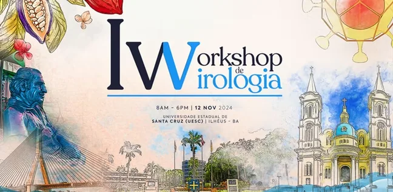
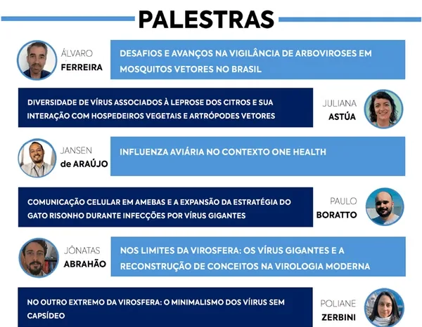
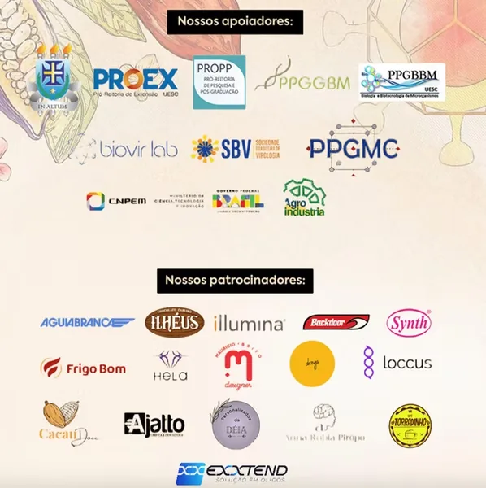
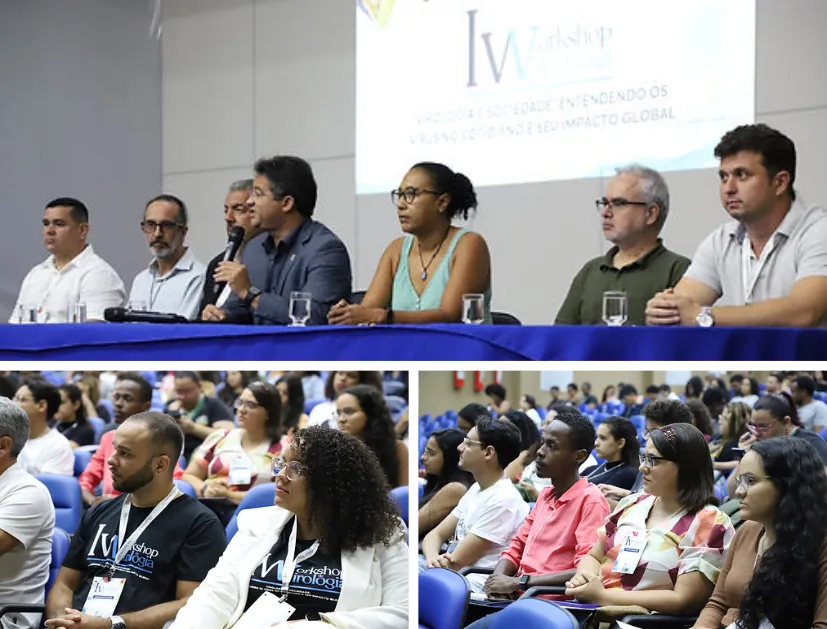

<!-- gerado por scripts/build-eventos.py - nao editar a mao;
     edite eventos/1_workshop_virologia/ e rode ./build.sh -->

<a class="no-external" href="../../eventos.html">← Todos os eventos</a>

::: {.event-meta}
12 nov 2024 · Ilhéus, BA
:::

{.event-cover fig-alt="I Workshop de Virologia"}

::: {.lead}
I Workshop de Virologia na UESC organizado pelos laboratórios de Bioinformática de Vírus (BioVirLab) e de Patologia Aplicada e Genética (LAPAGEN).
:::

O I Workshop de Virologia da UESC, realizado em 12 de novembro de 2024, foi um marco na divulgação científica na região Nordeste, reunindo estudantes, pesquisadores e profissionais da área da saúde e biológicas para discutir os avanços e desafios da virologia no Brasil. Com apoio da Sociedade Brasileira de Virologia (SBV), o evento foi o primeiro Workshop focado em Virologia no Sul e Extremo Sul da Bahia, e contou com palestras de especialistas de renome Nacional e Internacional, promovendo a troca de conhecimento, a valorização da ciência e a formação de redes colaborativas. A iniciativa também teve destaque na mídia regional, reforçando o compromisso da UESC com a ciência acessível e de qualidade.

## PROGRAMAÇÃO

Recebemos com grande satisfação no I Workshop de Virologia especialistas de diversas instituições de renome Nacional e Internacional importantes, como o Centro Nacional de Pesquisa em Energia e Materiais (CNPEM), Universidade Federal de Minas Gerais (UFMG), Universidade Federal de Viçosa (UFV), Fundação Oswaldo Cruz – Minas (FioCruz), Instituto Biológico/EMBRAPA e Universidade de São Paulo (USP).

As linhas de pesquisa e atualizações abordadas pelos palestrantes representaram com amplitude áreas correlatas com a virologia, desde o estudo de arboviroses com o Dr. Álvaro Ferreira, vírus de importância agrícola com a Dra. Juliana Astúa, bem como a contextualização do conceito de “One Health” com o Dr. Jansen de Araújo e a natureza de vírus gigantes com os doutores Paulo Boratto e Jônatas Abrahão. Infelizmente, por motivos de força maior, a Dra. Poliane Zerbini não pôde comparecer ao evento conforme o previsto.

Além da apresentação de informações atualizadas nas linhas de pesquisa de cada convidado, as interações entre palestrantes e ouvintes promoveram discussões científicas de alto nível, contribuindo para a construção coletiva do conhecimento. A participação ativa do público conferiu ao evento dinamismo, acessibilidade e uma atmosfera estimulante para a troca de saberes.

## ALCANCE DO EVENTO

O alcance geral dos ouvintes no I Workshop de Virologia foi de mais de 350 inscritos e cerca de 200 credenciados. Destacamos a ampla visibilidade do evento na mídia, com cobertura realizada pela TV UESC (vídeo disponível aqui) e pela TV Santa Cruz, afiliada da Rede Globo, cuja matéria pode ser conferida a partir dos 10 minutos e 33 segundos no link: [globoplay.globo.com/v/13095103](https://globoplay.globo.com/v/13095103).
Essas reportagens ressaltaram a relevância do Workshop de Virologia para a comunidade acadêmica e para a população em geral, reforçando a importância de iniciativas científicas acessíveis e de impacto regional.

## PATROCINADORES E APOIADORES

Além dos esforços da Comissão Organizadora para idealizar o I Workshop de Virologia, todo o alcance e realização só foram possíveis com a participação de empresas e instituições apoiadoras e patrocinadoras do evento. Novamente, expressamos a nossa gratidão a todos.

## Registros do Workshop

