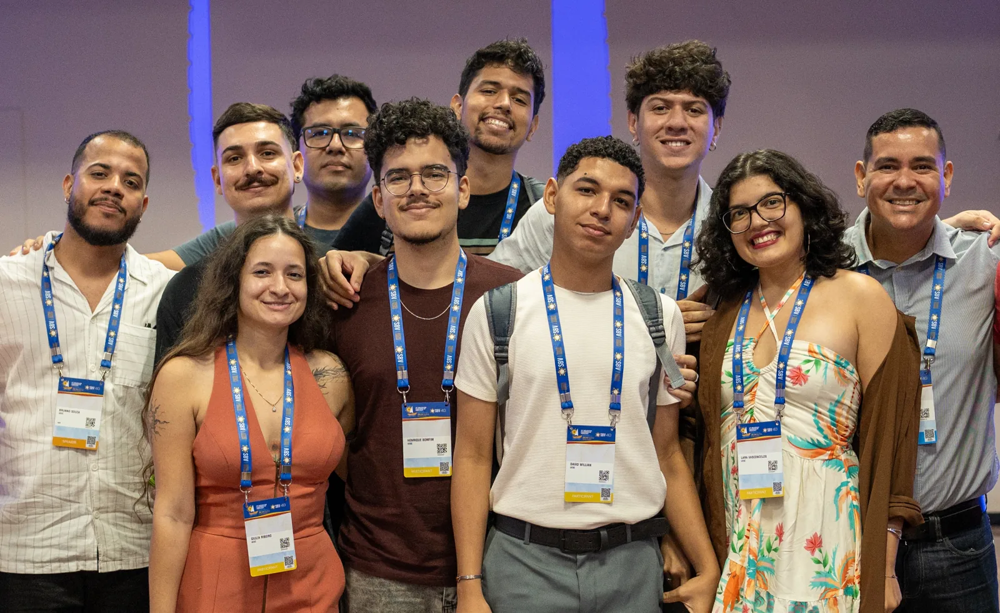
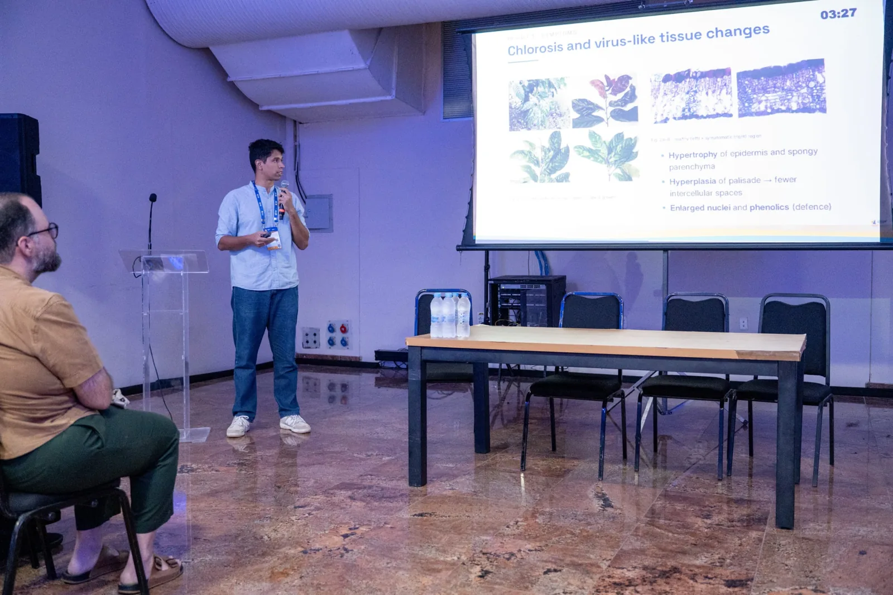
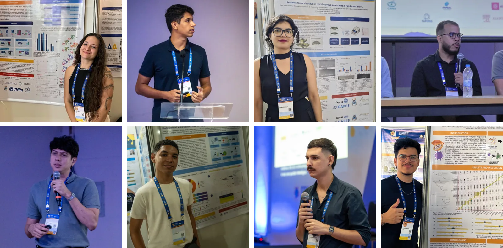

<!-- gerado por scripts/build-eventos.py - nao editar a mao;
     edite eventos/cbv_2026/ e rode ./build.sh -->

<a class="no-external" href="../../eventos.html">← Eventos e notícias</a>

::: {.event-meta}
20–24 out 2026 · Maceió, AL
:::

{.event-cover fig-alt="Congresso Brasileiro de Virologia 2026"}

::: {.lead}
Participação do BioVirLab no 37º Congresso Brasileiro de Virologia (CBV) e no 21º Encontro de Virologia do Mercosul (EVM).
:::

O estudante de Doutorado vinculado ao Laboratório de Bioinformática de Vírus (BioVirLab) da Universidade Estadual de Santa Cruz e Universidade Federal do Sul da Bahia, MSc. João Pedro Nunes Santos, foi ganhador do prêmio destaque de melhor apresentação oral na categoria de Bioinformática e Modelos Computacionais no 37º Congresso Brasileiro de Virologia. O evento foi realizado entre os dias 20 e 24 de outubro, na cidade de Maceió-AL e recebeu mais de 700 estudantes, pesquisadores, professores e profissionais da área. As conquistas reiteram a excelência das pesquisas desenvolvidas na UESC/UFSB e o impacto da ciência produzida na região Sul da Bahia a nível nacional e internacional.

Além do prêmio conquistado, membros do laboratório apresentaram trabalhos em todas as categorias do congresso: Pôsteres de graduação e pós-graduação (4 trabalhos); trabalhos de apresentação oral (3) e um trabalho aprovado na apresentação oral concorrendo ao prêmio Hélio Gelli Pereira (HGP) — que é concedido a estudantes e recém-graduados com trabalhos completos selecionados entre todo o país.

Entre os destaques do grupo, David Gabriel do Nascimento Souza apresentou um trabalho na categoria Prêmio HGP, com uma pesquisa sobre o viroma associado a flebotomíneos de diferentes regiões do mundo. Na modalidade de apresentações orais, foram mostrados os trabalhos de João Pedro Nunes Santos, Gabriel Victor Pina Rodrigues e Brunno Santos Mosquito de Souza, que abordaram temas como a endogenização de vírus de RNA em fungos fitopatogênicos, o desenvolvimento de ferramentas computacionais para caracterização de sequências virais e o mapeamento de epítopos de anticorpos neutralizantes nos vírus influenza A e B, respectivamente.

Na categoria de pôsteres, apresentaram David Willian Oliveira dos Santos, Giulia Verpa Narciso Ribeiro, Lara Beatriz Correia Moreira de Vasconcelos, Gabriel Victor Pina Rodrigues e Henrique Andrade Rabelo Bomfim, este último com dois trabalhos. As pesquisas abrangeram a identificação e caracterização de novos vírus em insetos, plantas, oomicetos e organismos aquáticos, análises imunoinformáticas do vírus da dengue e o desenvolvimento de ferramentas de bioinformática para integração de dados taxonômicos e sequências virais.

Para o coordenador do BioVirLab, o Professor Dr. Eric Aguiar, docente da UFSB e dos programas PPGMC/UESC e PPGGBM/UESC, os prêmios refletem o esforço conjunto e o caráter interdisciplinar do laboratório, além de mostrar que apostar na formação científica e na colaboração gera resultados concretos, com estudantes da graduação ao pós-doutorado reconhecidos no principal evento de virologia do Brasil.

Esse é o quinto ano consecutivo em que trabalhos do BioVirLab são reconhecidos com prêmios no Congresso Brasileiro de Virologia. Anteriormente, estudantes de graduação, pós-graduação e pesquisadores foram agraciados com prêmios de destaque.

Esse desempenho consolida a UESC e a UFSB como referências na formação de pesquisadores qualificados e na produção de pesquisas de ponta em virologia, biotecnologia e modelagem computacional. O apoio e incentivo da Universidade e da Pós-graduação aos alunos para a apresentação dos trabalhos foi fundamental para essas conquistas.

[Site do evento](https://cbv2026.com.br/index.html){.btn-biovir-ghost target="_blank" rel="noopener"}
