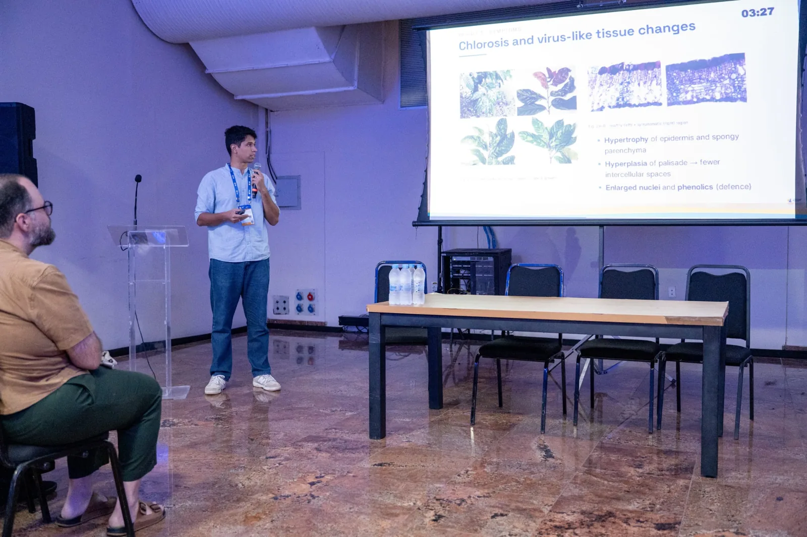
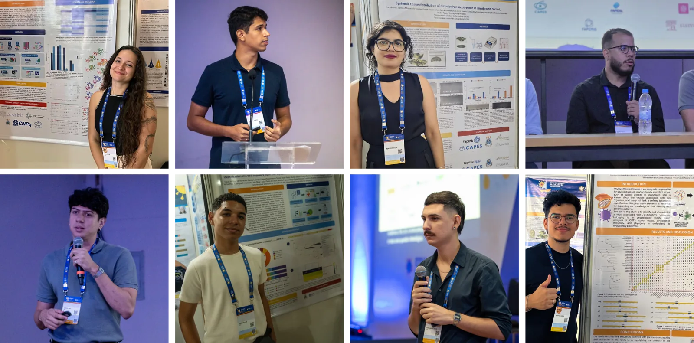

João Pedro Nunes Santos, MSc., a PhD student at the Virus Bioinformatics
Laboratory (BioVirLab) of the State University of Santa Cruz (UESC) and the
Federal University of Southern Bahia (UFSB), won the award for best oral
presentation in the Bioinformatics and Computational Models category at the
37th Brazilian Congress of Virology. The congress was held from 20 to 24 October
in Maceió, Alagoas, and brought together more than 700 students, researchers,
lecturers and professionals in the field. These achievements reaffirm the
excellence of the research carried out at UESC/UFSB and the national and
international impact of the science produced in southern Bahia.

Beyond the award, members of the laboratory presented work in every category of
the congress: undergraduate and graduate posters (4 works), oral presentations
(3) and one work selected for oral presentation in the running for the Hélio
Gelli Pereira (HGP) Award, which is given to students and recent graduates for
full papers selected from across the country.

Among the group's highlights, David Gabriel do Nascimento Souza presented in the
HGP Award category, with research on the virome associated with sand flies from
different regions of the world. In the oral presentation sessions, João Pedro
Nunes Santos, Gabriel Victor Pina Rodrigues and Brunno Santos Mosquito de Souza
presented work on, respectively, the endogenisation of RNA viruses in
plant-pathogenic fungi, the development of computational tools for
characterising viral sequences, and the mapping of neutralising antibody
epitopes in influenza A and B viruses.

In the poster category, presentations were given by David Willian Oliveira dos
Santos, Giulia Verpa Narciso Ribeiro, Lara Beatriz Correia Moreira de
Vasconcelos, Gabriel Victor Pina Rodrigues and Henrique Andrade Rabelo Bomfim,
the latter with two works. The research covered the identification and
characterisation of new viruses in insects, plants, oomycetes and aquatic
organisms, immunoinformatic analyses of dengue virus, and the development of
bioinformatics tools for integrating taxonomic data and viral sequences.

For BioVirLab's coordinator, Prof. Eric Aguiar, a lecturer at UFSB and in the
PPGMC/UESC and PPGGBM/UESC graduate programmes, the awards reflect the joint
effort and interdisciplinary character of the laboratory, and show that
investing in scientific training and collaboration delivers concrete results,
with students from undergraduate to postdoctoral level recognised at Brazil's
main virology meeting.

This is the fifth consecutive year in which BioVirLab's work has been recognised
with awards at the Brazilian Congress of Virology. In previous editions,
undergraduate and graduate students as well as researchers received distinction
awards.

This performance consolidates UESC and UFSB as references in training qualified
researchers and in producing cutting-edge research in virology, biotechnology
and computational modelling. The support and encouragement that the University
and its graduate programmes gave students to present their work were essential
to these achievements.
