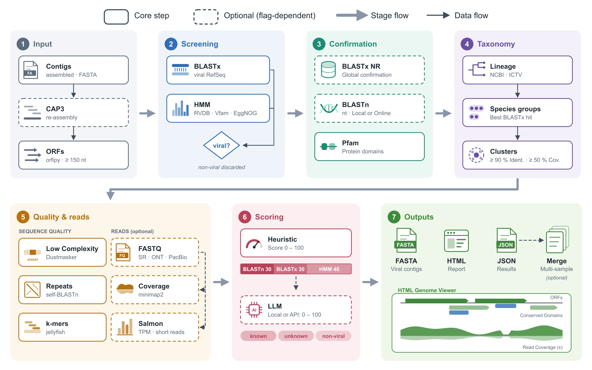

::: {.lead}
Software livre desenvolvido no laboratório para encontrar, classificar e
interpretar vírus em dados de sequenciamento. Escolha uma ferramenta e
percorra as etapas da análise.
:::

<!-- Para adicionar uma ferramenta: copie um <button class="tool-pick"> e um
     <section class="tool-panel"> abaixo, trocando o id (ex.: "nova-ferramenta").
     O comportamento (abas, etapas, filtro de leituras e contagem de programas)
     vem de js/ferramentas.js e funciona sem nenhuma outra alteração.
     A versão em inglês fica em en/tools.qmd. -->

```{=html}
<div class="tools" data-tools data-label-steps="etapas" data-label-progs="programas">

  <div class="tool-picker" role="tablist" aria-label="Ferramentas">
    <button class="tool-pick" type="button" role="tab" id="tab-viralquest"
            aria-controls="viralquest" data-tool="viralquest"
            style="--tool-accent:#3f7bc4">
      
      <span class="tool-pick-kind">Ferramenta · Python</span>
      <span class="tool-pick-desc">Descoberta de vírus em dados genéticos, com relatório interativo</span>
    </button>
    <button class="tool-pick" type="button" role="tab" id="tab-vapor"
            aria-controls="vapor" data-tool="vapor"
            style="--tool-accent:#14b8a6">
      
      <span class="tool-pick-kind">Pipeline · Snakemake</span>
      <span class="tool-pick-desc">Metagenômica viral e procariótica, das leituras aos relatórios</span>
    </button>
    <button class="tool-pick" type="button" role="tab" id="tab-viralfetch"
            aria-controls="viralfetch" data-tool="viralfetch"
            style="--tool-accent:#7c3aed">
      
      <span class="tool-pick-kind">Ferramenta · Python · CLI</span>
      <span class="tool-pick-desc">Taxonomia, metadados, sequências e árvores de vírus direto do terminal</span>
    </button>
    <button class="tool-pick" type="button" role="tab" id="tab-plancus"
            aria-controls="plancus" data-tool="plancus"
            style="--tool-accent:#c35c29">
      
      <span class="tool-pick-kind">Pipeline · Python · conda</span>
      <span class="tool-pick-desc">Busca, validação e curadoria de elementos virais endógenos (EVEs) em genomas</span>
    </button>
  </div>

  <!-- ============================================================ ViralQuest -->
  <section class="tool-panel" id="viralquest" role="tabpanel" aria-labelledby="tab-viralquest"
           style="--tool-accent:#3f7bc4; --tool-accent-dark:#04337e">

    <header class="tool-head">
      <div>
        <p class="eyebrow">Ferramenta · Código aberto · Gratuita</p>
        <h2 class="tool-name">ViralQuest</h2>
        <p class="tool-tagline">Encontrando vírus escondidos nos dados genéticos</p>
      </div>
      <div class="tool-actions">
        <a class="btn-biovir" href="https://github.com/gabrielvpina/viralquest">GitHub</a>
        <a class="btn-biovir-ghost" href="https://doi.org/10.1186/s12859-026-06391-6">Artigo · BMC Bioinformatics</a>
      </div>
    </header>

    <div class="tool-intro">
      <p>Os vírus estão por toda parte: em plantas, animais, pessoas e no
      ambiente. Mas a maioria deles ainda é desconhecida. Hoje os cientistas
      conseguem ler de uma só vez o material genético de uma amostra inteira,
      como uma folha, um inseto ou uma amostra de solo. Em meio a milhões de
      sequências, uma pergunta continua difícil de responder: <strong>quais
      delas pertencem a vírus?</strong></p>
      <p>O ViralQuest foi criado para responder a essa pergunta. É uma
      ferramenta de computador gratuita e de código aberto, desenvolvida no
      BioVirLab, e seus resultados foram publicados em revista científica
      internacional.</p>
    </div>

    <h3 class="tool-section">Como funciona <span class="tool-count" data-count></span></h3>

    <div class="flow" data-flow>
      <ol class="flow-steps">
        <li><button type="button" class="flow-step"><span class="flow-num">01</span><span class="flow-label">Amostra</span></button></li>
        <li><button type="button" class="flow-step"><span class="flow-num">02</span><span class="flow-label">Busca</span></button></li>
        <li><button type="button" class="flow-step"><span class="flow-num">03</span><span class="flow-label">Comparação</span></button></li>
        <li><button type="button" class="flow-step"><span class="flow-num">04</span><span class="flow-label">Classificação</span></button></li>
        <li><button type="button" class="flow-step"><span class="flow-num">05</span><span class="flow-label">Relatório</span></button></li>
      </ol>
      <div class="flow-details">
        <div class="flow-detail">
          <h4>Milhões de sequências de uma amostra inteira</h4>
          <p>O ponto de partida é o material genético lido de uma amostra
          completa — uma folha, um inseto, um pouco de solo — com sequências de
          todos os organismos presentes misturadas.</p>
        </div>
        <div class="flow-detail">
          <h4>Vasculhar os dados atrás de vírus</h4>
          <p>O ViralQuest percorre grandes volumes de dados genéticos e
          encontra as sequências de vírus, inclusive de vírus ainda não
          descritos.</p>
        </div>
        <div class="flow-detail">
          <h4>Comparar com bancos de dados internacionais</h4>
          <p>As sequências encontradas são comparadas com grandes bancos de
          dados internacionais de referência.</p>
        </div>
        <div class="flow-detail">
          <h4>Indicar o grupo viral e os genes</h4>
          <p>Para cada vírus, a ferramenta indica a qual grupo ele provavelmente
          pertence e quais genes ele carrega.</p>
        </div>
        <div class="flow-detail">
          <h4>Relatório interativo no navegador</h4>
          <p>No fim da análise, o ViralQuest gera um relatório que pode ser
          aberto em qualquer navegador, o que facilita interpretar e
          compartilhar os resultados.</p>
          <ul class="flow-chips flow-chips-plain">
            <li>gráficos</li>
            <li>mapas do genoma viral</li>
            <li>tabelas organizadas</li>
          </ul>
        </div>
      </div>
    </div>

    <h3 class="tool-section">Esquema da pipeline</h3>
    <figure class="tool-figure">
      <a href="assets/viralquest-scheme.webp" target="_blank" rel="noopener">
        
      </a>
      <figcaption>As sete etapas do ViralQuest, da entrada dos contigs ao relatório. Caixas tracejadas são etapas opcionais. Clique para ampliar.</figcaption>
    </figure>

    <h3 class="tool-section">Para que serve</h3>
    <div class="card-grid tool-cards">
      <div class="info-card"><h3>Descobrir novos vírus</h3><p>Em diferentes organismos e ambientes.</p></div>
      <div class="info-card"><h3>Medir a diversidade viral</h3><p>Entender quais vírus estão presentes em uma amostra.</p></div>
      <div class="info-card"><h3>Agilizar a pesquisa</h3><p>Em saúde, agricultura e meio ambiente, transformando dados brutos em informação útil.</p></div>
    </div>
  </section>

  <!-- ================================================================= VAPOR -->
  <section class="tool-panel" id="vapor" role="tabpanel" aria-labelledby="tab-vapor"
           style="--tool-accent:#14b8a6; --tool-accent-dark:#0f766e">

    <header class="tool-head">
      <div>
        <p class="eyebrow">Pipeline · Snakemake · Código aberto</p>
        <h2 class="tool-name">VAPOR</h2>
        <p class="tool-tagline">Viral And Prokaryotic mOdular pipelineR</p>
      </div>
      <div class="tool-actions">
        <a class="btn-biovir" href="https://github.com/LymF/vapor">GitHub</a>
      </div>
    </header>

    <div class="tool-intro">
      <p>O VAPOR é uma pipeline em Snakemake que recebe leituras de
      sequenciamento metagenômico — curtas (Illumina, pareadas ou não) ou
      longas (Nanopore e PacBio HiFi) — e roda automaticamente uma sequência de
      análises, configurada por <strong>um único arquivo de
      parâmetros</strong>.</p>
    </div>

    <h3 class="tool-section">Etapas da pipeline <span class="tool-count" data-count></span></h3>

    <div class="flow" data-flow>
      <div class="reads-toggle" data-reads-toggle role="group" aria-label="Tipo de leitura">
        <span class="reads-toggle-label">Destacar programas para</span>
        <button type="button" data-reads="all" aria-pressed="true">Todas</button>
        <button type="button" data-reads="short" aria-pressed="false">Leituras curtas</button>
        <button type="button" data-reads="long" aria-pressed="false">Leituras longas</button>
      </div>
      <ol class="flow-steps">
        <li><button type="button" class="flow-step"><span class="flow-num">01</span><span class="flow-label">Qualidade</span></button></li>
        <li><button type="button" class="flow-step"><span class="flow-num">02</span><span class="flow-label">Montagem</span></button></li>
        <li><button type="button" class="flow-step"><span class="flow-num">03</span><span class="flow-label">Vírus</span></button></li>
        <li><button type="button" class="flow-step"><span class="flow-num">04</span><span class="flow-label">Procariotos</span></button></li>
        <li><button type="button" class="flow-step"><span class="flow-num">05</span><span class="flow-label">Anotação</span></button></li>
        <li><button type="button" class="flow-step"><span class="flow-num">06</span><span class="flow-label">Abundância</span></button></li>
      </ol>
      <div class="flow-details">
        <div class="flow-detail">
          <h4>Controle de qualidade das leituras</h4>
          <p>Limpeza e avaliação das leituras antes de qualquer análise.</p>
          <ul class="flow-chips">
            <li data-reads="short">fastp</li>
            <li data-reads="long">NanoPlot</li>
            <li data-reads="long">Porechop</li>
            <li data-reads="long">Filtlong</li>
          </ul>
        </div>
        <div class="flow-detail">
          <h4>Montagem em contigs</h4>
          <p>MEGAHIT para leituras curtas; Flye com Medaka ou metaMDBG para
          longas. A montagem é avaliada pelo QUAST. Um módulo opcional
          classifica as leituras diretamente, sem montagem.</p>
          <ul class="flow-chips">
            <li data-reads="short">MEGAHIT</li>
            <li data-reads="long">Flye</li>
            <li data-reads="long">Medaka</li>
            <li data-reads="long">metaMDBG</li>
            <li>QUAST</li>
            <li class="is-optional">Sylph</li>
          </ul>
        </div>
        <div class="flow-detail">
          <h4>Parte viral</h4>
          <p>Detecta contigs virais, avalia completude, recorta provírus, agrupa
          contigs em genomas e monta um catálogo de vOTUs, agrupando os vírus
          de todas as amostras por similaridade.</p>
          <ul class="flow-chips">
            <li>VirSorter2</li>
            <li>geNomad</li>
            <li>CheckV</li>
            <li>vRhyme</li>
            <li>skani</li>
          </ul>
        </div>
        <div class="flow-detail">
          <h4>Parte procariótica</h4>
          <p>Reconstrói genomas com vários binners, escolhe os melhores, checa
          qualidade e contaminação, remove redundância e classifica.</p>
          <ul class="flow-chips">
            <li>MetaBAT2</li>
            <li>VAMB</li>
            <li>SemiBin2</li>
            <li>Binette</li>
            <li>CheckM2</li>
            <li>GUNC</li>
            <li>GTDB-Tk</li>
          </ul>
        </div>
        <div class="flow-detail">
          <h4>Taxonomia, hospedeiros e anotação</h4>
          <p>Taxonomia viral contra o INPHARED, predição de hospedeiros, busca de
          genes de resistência a antibióticos e de sistemas de defesa, e
          anotação funcional.</p>
          <ul class="flow-chips">
            <li>MMseqs2</li>
            <li>PHIST</li>
            <li>AMRFinderPlus</li>
            <li>RGI</li>
            <li>DefenseFinder</li>
            <li>Pharokka</li>
            <li>Phold</li>
            <li>Bakta</li>
            <li>EggNOG</li>
          </ul>
        </div>
        <div class="flow-detail">
          <h4>Abundância e diversidade</h4>
          <p>Cálculo de abundância por amostra e métricas de diversidade alfa e
          beta.</p>
          <ul class="flow-chips">
            <li>CoverM</li>
          </ul>
        </div>
      </div>
      <p class="flow-legend"><span class="flow-legend-opt">opcional</span> módulo que pode ser ligado no arquivo de parâmetros</p>
    </div>

    <h3 class="tool-section">O que sai</h3>
    <div class="card-grid tool-cards">
      <div class="info-card"><h3>Genomas</h3><p>Genomas virais e procarióticos organizados, com mapas circulares.</p></div>
      <div class="info-card"><h3>Tabelas</h3><p>Taxonomia, qualidade, hospedeiros, genes de resistência e de defesa.</p></div>
      <div class="info-card"><h3>Matrizes e diversidade</h3><p>Presença e abundância por amostra; diversidade alfa e beta.</p></div>
      <div class="info-card"><h3>Relatórios</h3><p>Um relatório MultiQC e um relatório HTML interativo reunindo tudo.</p></div>
    </div>
  </section>

  <!-- ============================================================ viralfetch -->
  <section class="tool-panel" id="viralfetch" role="tabpanel" aria-labelledby="tab-viralfetch"
           style="--tool-accent:#7c3aed; --tool-accent-dark:#1e1b4b; --tool-accent-soft:#c4b5fd; --tool-term-bg:#1e1b4b">

    <header class="tool-head">
      <div>
        <p class="eyebrow">Ferramenta · Linha de comando · Código aberto</p>
        <h2 class="tool-name">viralfetch</h2>
        <p class="tool-tagline">Taxonomia, metadados e sequências de vírus, direto do terminal</p>
      </div>
      <div class="tool-actions">
        <a class="btn-biovir" href="https://github.com/gabrielvpina/viralfetch">GitHub</a>
        <a class="btn-biovir-ghost" href="https://pypi.org/project/viralfetch/">PyPI</a>
      </div>
    </header>

    <div class="tool-intro">
      <p>O viralfetch é uma ferramenta de linha de comando para consultar e
      baixar taxonomia viral, metadados, sequências e as árvores filogenéticas
      e alinhamentos de cada família viral. Um nome de vírus basta: a
      ferramenta encontra a linhagem, os acessos no GenBank/RefSeq e os dados
      relacionados, <strong>juntando quatro fontes</strong> em uma só
      consulta.</p>
      <p>Toda saída pode ser pedida em <code>--json</code>, pronta para
      scripts e para o <code>jq</code>; dados baixados ficam em cache, e nomes
      que o índice local não conhece são procurados na taxonomia do NCBI.</p>
    </div>

    <div class="tool-install">
      <span class="tool-install-label">Instalação</span>
      <code>pip install viralfetch</code>
    </div>

    <h3 class="tool-section">Comandos <span class="tool-count" data-count data-label-steps="comandos"></span></h3>

    <div class="flow" data-flow>
      <ol class="flow-steps">
        <li><button type="button" class="flow-step"><span class="flow-num">01</span><span class="flow-label">tax</span></button></li>
        <li><button type="button" class="flow-step"><span class="flow-num">02</span><span class="flow-label">members</span></button></li>
        <li><button type="button" class="flow-step"><span class="flow-num">03</span><span class="flow-label">seq</span></button></li>
        <li><button type="button" class="flow-step"><span class="flow-num">04</span><span class="flow-label">text</span></button></li>
        <li><button type="button" class="flow-step"><span class="flow-num">05</span><span class="flow-label">tree</span></button></li>
        <li><button type="button" class="flow-step"><span class="flow-num">06</span><span class="flow-label">msa</span></button></li>
      </ol>
      <div class="flow-details">
        <div class="flow-detail">
          <h4><code class="flow-cmd">viralfetch tax</code> Linhagem taxonômica</h4>
          <p>Mostra a linhagem completa do ICTV (do reino à espécie). Pode consultar direto a taxonomia do NCBI ou comparar as duas lado a lado, destacando onde divergem.</p>
          <ul class="flow-chips flow-chips-flags">
            <li>--ncbi</li>
            <li>--compare-ncbi</li>
          </ul>
          <pre class="flow-term"><code>$ viralfetch tax Coronaviridae
╭─ Coronaviridae  (family) ──╮
│ realm     Riboviria        │
│ kingdom   Orthornavirae    │
│ phylum    Pisuviricota     │
│ class     Pisoniviricetes  │
│ order     Nidovirales      │
│ suborder  Cornidovirineae  │
│ family    Coronaviridae  ◀ │
╰────────────────────────────╯</code></pre>
        </div>
        <div class="flow-detail">
          <h4><code class="flow-cmd">viralfetch members</code> Táxons abaixo de um grupo</h4>
          <p>Lista os táxons de um grupo em um nível escolhido, só a contagem, ou a árvore completa de descendentes.</p>
          <ul class="flow-chips flow-chips-flags">
            <li>--rank</li>
            <li>--count</li>
            <li>--tree</li>
          </ul>
          <pre class="flow-term"><code>$ viralfetch members Coronaviridae --rank genus
genera in family Coronaviridae
┏━━━━━━━━━━━━━━━━━━┳━━━━━━━━━┓
┃ genus            ┃ species ┃
┡━━━━━━━━━━━━━━━━━━╇━━━━━━━━━┩
│ Alphacoronavirus │      26 │
│ Alphaletovirus   │       1 │
│ Alphapironavirus │       1 │
│ Betacoronavirus  │      14 │
│ Deltacoronavirus │       7 │
│ Gammacoronavirus │       5 │
└──────────────────┴─────────┘
           6 genera</code></pre>
        </div>
        <div class="flow-detail">
          <h4><code class="flow-cmd">viralfetch seq</code> Sequências do NCBI</h4>
          <p>Resolve os acessos localmente no VMR e baixa metadados, FASTA ou GenBank do NCBI. Para um grupo inteiro, mostra antes uma estimativa local do tamanho do download.</p>
          <ul class="flow-chips flow-chips-flags">
            <li>--meta</li>
            <li>--fasta</li>
            <li>--gb</li>
            <li>--taxon</li>
            <li>--protein</li>
          </ul>
          <pre class="flow-term"><code>$ viralfetch seq &quot;Betacoronavirus pandemicum&quot; --fasta -o out.fa
Wrote 4 fasta record(s) for Betacoronavirus pandemicum to out.fa

$ viralfetch seq --taxon Coronaviridae --meta
╭─ Coronaviridae (family) — download estimate ─╮
│ species     54                               │
│ isolates    59                               │
│ accessions  59                               │
╰──────────────────────────────────────────────╯</code></pre>
        </div>
        <div class="flow-detail">
          <h4><code class="flow-cmd">viralfetch text</code> Capítulo do ICTV Report</h4>
          <p>Traz o capítulo da família no ICTV Report em Markdown, com tabelas e nomes científicos em itálico. As figuras podem ser desenhadas no próprio terminal.</p>
          <ul class="flow-chips flow-chips-flags">
            <li>--section</li>
            <li>--raw</li>
            <li>--images</li>
          </ul>
          <pre class="flow-term"><code>$ viralfetch text Coronaviridae --section summary
                  Family: Coronaviridae

Source: https://ictv.global/report/chapter/coronaviridae/coronaviridae
Content is licensed CC BY 4.0
──────────────────────────────────────────────────────
Summary

Members of the family Coronaviridae, a monophyletic group
of viruses in the order Nidovirales, are enveloped,
positive-sense RNA viruses …</code></pre>
        </div>
        <div class="flow-detail">
          <h4><code class="flow-cmd">viralfetch tree</code> Árvore filogenética</h4>
          <p>Desenha a árvore filogenética da família, sem precisar de internet, destacando a espécie ou o gênero consultado.</p>
          <ul class="flow-chips flow-chips-flags">
            <li>--tree N</li>
            <li>--newick</li>
            <li>--chapter</li>
          </ul>
          <pre class="flow-term"><code>$ viralfetch tree &quot;Betacoronavirus pandemicum&quot;
Coronaviridae · Figure 5A · RdRp (AA) · 55 tips · 2 matches
     ┌─ Alphacoronavirus BT020
   ┌─┤
   │ └─ Scotophilus bat coronavirus 512
  ─┤          …
   │     ┌ severe acute respiratory syndrome coronavirus  ← match
   └─────┤
         └ severe acute respiratory syndrome coronavirus 2  ← match</code></pre>
        </div>
        <div class="flow-detail">
          <h4><code class="flow-cmd">viralfetch msa</code> Alinhamento múltiplo</h4>
          <p>Mostra o alinhamento por trás da árvore, colorido por resíduo, com a sequência consultada marcada. Exporta o alinhamento em FASTA.</p>
          <ul class="flow-chips flow-chips-flags">
            <li>--range</li>
            <li>--consensus</li>
            <li>--fasta</li>
          </ul>
          <pre class="flow-term"><code>$ viralfetch msa &quot;Betacoronavirus pandemicum&quot; --consensus
Coronaviridae · tree1 · AA · cols 1–60 of 316 · 55 seqs
consensus              KHFFFAQDGDAAITDYDYYRYNRPTMLDICQALFVYEVVDKYFD
▶ severe acute respir  KHFFFAQDGNAAISDYDYYRYNLPTMCDIRQLLFVVEVVDKYFD
Alphapironavirus bona  EHFFYLQPRDCAVTDFDYYRFNRPTVLDPLQFRFVYNVVKHYFK
…                      0^                 20^                 40^</code></pre>
        </div>
      </div>
    </div>

    <h3 class="tool-section">Fontes de dados</h3>
    <div class="card-grid tool-cards">
      <div class="info-card"><span class="source-tag source-local">local</span><h3>VMR do ICTV</h3><p>Hierarquia taxonômica, isolados de referência e acessos GenBank/RefSeq. É o índice local, embutido no pacote.</p></div>
      <div class="info-card"><span class="source-tag source-remote">remoto</span><h3>NCBI E-utilities</h3><p>Metadados, sequências de nucleotídeos e proteínas e taxonomia do NCBI, buscados sob demanda.</p></div>
      <div class="info-card"><span class="source-tag source-remote">remoto</span><h3>ICTV Report</h3><p>O texto descritivo do capítulo de cada família, com figuras.</p></div>
      <div class="info-card"><span class="source-tag source-local">local</span><h3>Árvores do ICTV Report</h3><p>Árvores em Newick e alinhamentos de aminoácidos e nucleotídeos por família, incluídos no pacote.</p></div>
    </div>
  </section>

  <!-- =============================================================== PLANCUS -->
  <section class="tool-panel" id="plancus" role="tabpanel" aria-labelledby="tab-plancus"
           style="--tool-accent:#c35c29; --tool-accent-dark:#7a3412; --tool-accent-soft:#f3b48a">

    <header class="tool-head">
      <div>
        <p class="eyebrow">Pipeline · Código aberto · MIT</p>
        <h2 class="tool-name">PLANCUS</h2>
        <p class="tool-tagline">Elementos virais endógenos, do genoma ao catálogo curado</p>
      </div>
      <div class="tool-actions">
        <a class="btn-biovir" href="https://github.com/Bioinscripts/plancus">GitHub</a>
      </div>
    </header>

    <div class="tool-intro">
      <p>Ao longo da evolução, pedaços de vírus ficaram integrados ao genoma de
      plantas e animais. Esses <strong>elementos virais endógenos
      (EVEs)</strong> funcionam como fósseis moleculares: registram infecções
      antigas e ajudam a entender como vírus e hospedeiros evoluíram
      juntos.</p>
      <p>O PLANCUS transforma um genoma em um catálogo curado de EVEs. A
      entrada pode ser um FASTA (com GFF3 opcional), um acesso
      <code>GCA_</code>/<code>GCF_</code> do NCBI, baixado automaticamente, ou
      uma tabela com várias espécies, para comparar EVEs entre elas.</p>
    </div>

    <div class="tool-install">
      <span class="tool-install-label">Instalação</span>
      <code>conda env create -f environment.yml</code>
    </div>

    <h3 class="tool-section">Etapas da pipeline <span class="tool-count" data-count></span></h3>

    <div class="flow" data-flow>
      <ol class="flow-steps">
        <li><button type="button" class="flow-step"><span class="flow-num">01</span><span class="flow-label">ORFs</span></button></li>
        <li><button type="button" class="flow-step"><span class="flow-num">02</span><span class="flow-label">Resgate</span></button></li>
        <li><button type="button" class="flow-step"><span class="flow-num">03</span><span class="flow-label">Validação</span></button></li>
        <li><button type="button" class="flow-step"><span class="flow-num">04</span><span class="flow-label">Domínios</span></button></li>
        <li><button type="button" class="flow-step"><span class="flow-num">05</span><span class="flow-label">Contexto</span></button></li>
        <li><button type="button" class="flow-step"><span class="flow-num">06</span><span class="flow-label">Repetições</span></button></li>
        <li><button type="button" class="flow-step"><span class="flow-num">07</span><span class="flow-label">Comparação</span></button></li>
        <li><button type="button" class="flow-step"><span class="flow-num">08</span><span class="flow-label">Curadoria</span></button></li>
      </ol>
      <div class="flow-details">
        <div class="flow-detail">
          <h4>Triagem de ORFs</h4>
          <p>Prediz as ORFs do genoma, remove as redundantes e as compara com proteínas virais.</p>
          <ul class="flow-chips">
            <li>orfipy</li>
            <li>MMseqs2</li>
            <li>DIAMOND</li>
          </ul>
        </div>
        <div class="flow-detail">
          <h4>Resgate por HMM</h4>
          <p>ORFs sem semelhança viral são buscadas de novo com modelos HMM virais calibrados, que captam parentescos mais distantes.</p>
          <ul class="flow-chips">
            <li>pyhmmer</li>
            <li>RVDB</li>
            <li>eggNOG</li>
          </ul>
        </div>
        <div class="flow-detail">
          <h4>Validação</h4>
          <p>Cada candidato é comparado com o Swiss-Prot, pesando evidência viral contra celular; a família viral vem da taxonomia do NCBI.</p>
          <ul class="flow-chips">
            <li>Swiss-Prot</li>
            <li>NCBI Taxonomy</li>
          </ul>
        </div>
        <div class="flow-detail">
          <h4>Domínios proteicos</h4>
          <p>Anotação opcional dos domínios conservados de cada candidato.</p>
          <ul class="flow-chips">
            <li class="is-optional">CD-Search</li>
            <li class="is-optional">Pfam-A</li>
          </ul>
        </div>
        <div class="flow-detail">
          <h4>Contexto genômico</h4>
          <p>Ancora os candidatos no genoma, agrupa-os em loci com as regiões vizinhas e faz uma última busca por fragmentos sem ORF.</p>
          <ul class="flow-chips">
            <li>tblastn</li>
          </ul>
        </div>
        <div class="flow-detail">
          <h4>Repetições e transposons</h4>
          <p>Opcional: regiões de baixa complexidade, repetições mascaradas e domínios de transposons perto de cada EVE.</p>
          <ul class="flow-chips">
            <li class="is-optional">DUST</li>
            <li class="is-optional">SEG</li>
          </ul>
        </div>
        <div class="flow-detail">
          <h4>Comparação entre espécies</h4>
          <p>Agrupamento em duas etapas, mapa de calor das sequências compartilhadas e sintenia das regiões vizinhas.</p>
          <ul class="flow-chips">
            <li>tblastx</li>
          </ul>
        </div>
        <div class="flow-detail">
          <h4>Curadoria</h4>
          <p>Uma página local no navegador para inspecionar, aprovar ou remover cada candidato — com cobertura de leituras quando há RNA-seq ou BAM.</p>
          <ul class="flow-chips">
            <li>página de curadoria</li>
          </ul>
        </div>
      </div>
      <p class="flow-legend"><span class="flow-legend-opt">opcional</span> etapa que pode ser ligada na execução</p>
    </div>

    <h3 class="tool-section">O que sai</h3>
    <div class="card-grid tool-cards">
      <div class="info-card"><h3>Catálogo curado</h3><p>EVEs validados e revisados, com as decisões de curadoria registradas.</p></div>
      <div class="info-card"><h3>Figuras e painel</h3><p>Gráficos e um painel estático para explorar os resultados.</p></div>
      <div class="info-card"><h3>Comparação entre espécies</h3><p>Grupos de EVEs compartilhados, mapa de calor e sintenia.</p></div>
      <div class="info-card"><h3>Reprodutibilidade</h3><p>Log da execução e versão dos bancos de dados usados em cada análise.</p></div>
    </div>
  </section>

</div>
<script src="js/ferramentas.js"></script>
```
